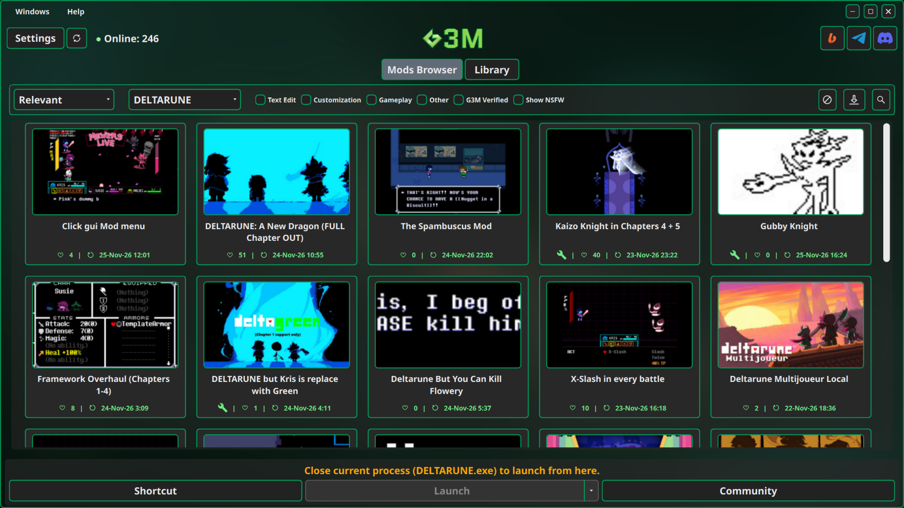
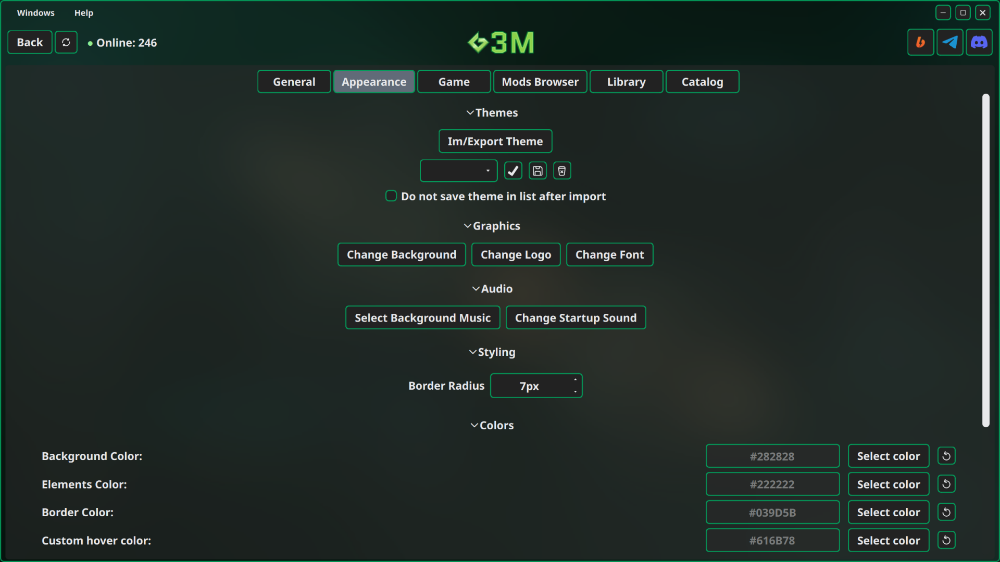

<!-- markdownlint-disable MD013 MD033 MD041 -->

<a id="readme-top"></a>

<p align="center">
  
</p>

<h1 align="center">G3M</h1>
<p align="center">
  Desktop mod manager for GameMaker games.
</p>

<p align="center">
  <a href="https://github.com/y114git/G3M/releases/latest"></a>
  <a href="https://github.com/y114git/G3M/releases"></a>
  <a href="LICENSE"></a>
  
  
</p>

<p align="center">
  <a href="https://github.com/y114git/G3M/releases/latest">Download</a>
  ·
  <a href="https://g3m.gitbook.io/g3m-wiki">Wiki</a>
  ·
  <a href="https://github.com/y114git/G3M/issues">Issues</a>
  ·
  <a href="CHANGELOG.md">Changelog</a>
  ·
  <a href="https://discord.gg/2MFdvFfD9a">Discord</a>
  ·
  <a href="https://t.me/y_maintg">Telegram</a>
</p>

<details>
<summary><strong>Table of Contents</strong></summary>

- [What Is G3M](#what-is-g3m)
- [Highlights](#highlights)
- [A Closer Look](#a-closer-look)
- [Features](#features)
- [Supported Games](#supported-games)
- [Catalog](#catalog)
- [Build From Source](#build-from-source)
- [Development and Tests](#development-and-tests)
- [Customization and Localization](#customization-and-localization)
- [Legal](#legal)

</details>

## What Is G3M

G3M *(formerly DELTAHUB)* is a desktop manager for GameMaker mods. Browse GameBanana, install and organize mods, switch profiles, create patches, and launch supported games from one app.

G3M currently supports DELTARUNE, DELTARUNE Demo, UNDERTALE, UNDERTALE Yellow, Pizza Tower, Sugary Spire, and FRICKBEARS3. You can also add custom games through the in-app Game Manager.

Release downloads are available for Windows, Linux, and macOS on both x86_64 and ARM64 computers.

## Highlights

- Browse, install, launch, edit, convert, and package mods without switching between several tools.
- Keep separate playthroughs, test setups, or modpacks in profiles with their own active mods and launch settings.
- Create patches, merge mods, compare files, and prepare installs from the same application.
- Download plugins and themes from the Catalog, manage saves, and customize G3M's appearance.
- Keep download history, mod versions, and game restore points.

## A Closer Look

<p align="center">
  
  <br>
  <em>Browse GameBanana inside the app, with filters for game, tags and verified mods.</em>
</p>

<p align="center">
  
  <br>
  <em>Change background, logo, font, music, colors and border radius, or import and export a whole theme.</em>
</p>

## Features

### Discovery and installation

- Browse supported GameBanana games directly in the app, with metadata, screenshots, descriptions, and per-post file selection when a page has multiple compatible downloads.
- Install from GameBanana, external URLs, local archives, or one-click install links.
- Use Manual Install to configure downloaded files in one window. G3M fills in GameBanana details and detects confirmed patch destinations. Configure multiple files or folders together and read the mod's instructions during setup.
- Hide unwanted browser results with the blocklist manager. Entries can be scoped globally or per game, and can block by mod ID, name, or category.

### Library, profiles, and versions

- Manage installed mods in a local library with drag-and-drop import and export, README viewing, screenshots, and mod metadata.
- Create multiple library profiles with their own active mod selections and profile-scoped settings. Profiles can be created, renamed, duplicated, deleted, reordered, exported, and imported.
- Save per-mod version snapshots in each mod folder. Versions can be created locally, imported from archives, switched back in place, deleted, and downloaded from GameBanana for supported linked mods.
- Update several GameBanana mods at once from Update Mods, with a backup of the current version by default. Optional automatic updates can cover one game, one profile, or all profiles.
- Save game versions as restore points, with or without a profile's mods applied. Restore, export, or import them when needed.

### Mod creation, editing, and conversion

- Create mods in the Mod Editor. Combine patches, file replacements, and archive contents, arrange their order, then export the mod to share it.
- Use folder references that follow each player's game setup, and define reusable names for paths used throughout a mod.
- Set required and incompatible mods in the Compatibility tab, along with any required order. Built-in help explains the editor's options.
- Import DELTAMOD packages and supported PizzaOven mods into your library.
- Import CYOP/AFOM-style Pizza Tower mods and keep them alongside your other mods in G3M.

### Patching and modding tools

- Use the built-in Modding Tools window to create patches, apply patches, merge patch sets, inspect patch info, compare files, and export diff reports.
- Convert mods between full game files and supported patch formats, including `.g3mpatch` and `.xdelta`.
- Launch multi-mod setups and create packaged modpacks. Use the diagnostics preview to see planned changes and conflicts before launching.

### Launch and compatibility

- Launch supported games with or without mods, directly or through Steam where available.
- Create standalone shortcuts that launch the selected game, profile, chapter, and mods without opening the full G3M window first.
- Choose DELTARUNE chapters directly where supported and select mods for individual chapters.
- Use PortProton on Linux for compatible Windows games.
- Choose whether to restore game files after playing, keep mods applied, or apply them without starting the game.
- Review required mods and suggested arrangements before launch. G3M can activate installed requirements and download missing ones from GameBanana when available.

### Downloads and recovery

- Track downloads in a dedicated queue with progress and status information.
- Retry, cancel, install, overwrite, continue manual setup, or delete entries from the downloads window as needed.
- Control download behavior from settings. G3M supports disabling automatic use after download, deleting downloaded files after use, and keeping local imports in download history.

### Interface and help

- Open built-in About and Changelog dialogs without leaving the app. The About dialog links to releases, wiki, issues, the local G3M data folder, Discord, and Telegram.
- Switch between installed themes or import and export theme archives. Theme packages can include color settings, media assets, and custom fonts.
- Change UI scale, border radius, theme colors, background media, and startup sound behavior from settings.
- Hide the Library tab if you want a slimmer layout for browsing and tool-focused use.
- Use bundled language packs or add external language files. G3M currently ships with English, Russian, Spanish, Korean, Japanese, Chinese Simplified, and Chinese Traditional.

## Supported Games

| Game | Browser / GameBanana | Library / Launch | Notes |
| --- | --- | --- | --- |
| DELTARUNE | Yes | Yes | Chapter selection and mods for individual chapters; Steam launch available. |
| DELTARUNE Demo | No (Download from DELTARUNE) | Yes | Supports local use and has a built-in full-install. |
| UNDERTALE | Yes | Yes | Steam launch available. |
| UNDERTALE Yellow | Yes | Yes | Includes a built-in full-install. |
| Pizza Tower | Yes | Yes | Includes PizzaOven conversion and CYOP/AFOM handling. |
| Sugary Spire | Yes | Yes | Built-in game download and installation. |
| FRICKBEARS3 | Yes | Yes | Built-in game download and installation. |

Add custom GameMaker games in the Game Manager, choose their game files, and optionally connect Steam launch and GameBanana browsing.

## Catalog

Open *Settings > Catalog* to browse plugins and themes.

Install themes, apply them, or remove them from the Themes section. Themes can include colors, backgrounds, music, startup sounds, and fonts. Installed themes are also available in *Appearance*.

Plugins add tools and extra screens. Install them from the Plugins section or a local archive, then enable them to use their features. Available plugins include:

- `DR Save Manager` for collecting, switching, and editing DELTARUNE saves.
- `Custom Saves Folders` for choosing different save folders for games, profiles, or selected mods.

## Build From Source

G3M requires Python 3.14 or newer.

```bash
git clone https://github.com/y114git/G3M.git
cd G3M
python -m pip install -e ".[dev,test,build]"
python src/main.py
```

To build an executable:

```bash
pyinstaller builds/G3MExecutable.spec
```

## Development and Tests

Run the full automated suite with:

```bash
pytest
```

Useful local commands:

```bash
ruff check .
basedpyright
pytest tests/unit
pytest tests/integration
pytest tests/ui
```

The repository includes unit, integration, and Qt UI coverage for core areas such as protocol handling, downloads, profiles, plugin services, GameBanana integration, patching, game versions, dialogs, and widgets.

## Customization and Localization

Import and export themes, add custom fonts and language packs, or adjust the built-in appearance settings. See the [G3MWiki](https://g3m.gitbook.io/g3m-wiki) for setup guides and details about creating themes, translations, plugins, and mods.

## Legal

- [License](LICENSE)
- [Security Policy](SECURITY.md)
- [Third-Party Notices](THIRD_PARTY_NOTICES.md)

<p align="right"><a href="#readme-top">Back to top</a></p>
